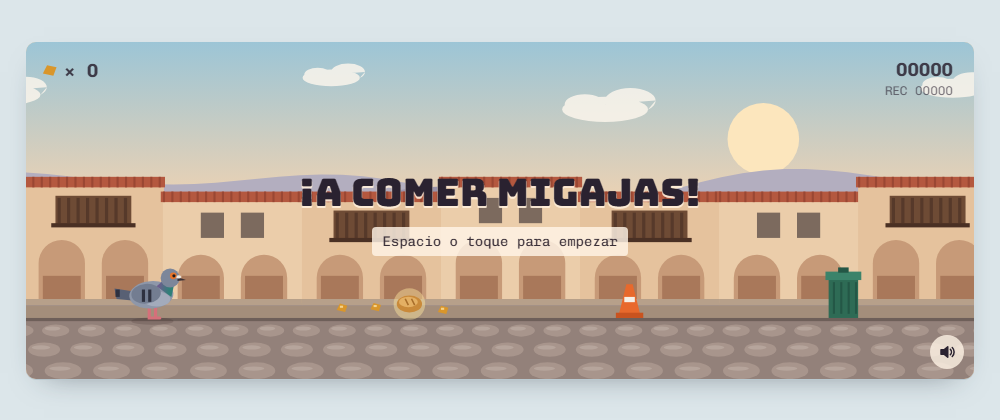

# 🕊️ La Paloma Migajera

Juego de navegador tipo *endless runner*: una paloma recorre una calle de portales coloniales con techos de teja y balcones de madera, salta y se agacha para esquivar obstáculos mientras come todas las migajas que encuentra.

## Cómo jugar

| Acción | Teclado | Celular |
|---|---|---|
| Empezar / reintentar | `Espacio` | Toca la pantalla |
| Saltar (mantén para saltar más alto) | `Espacio`, `↑` o `W` | Botón ▲ o toca el juego |
| Agacharse (en el aire: caer rápido) | `↓` o `S` | Botón ▼ |
| Silenciar | `M` | Botón 🔊 |

### Puntaje
- La distancia recorrida suma puntos de forma continua.
- **Migaja:** +5 puntos.
- **Pan:** +25 puntos (vale 5 migajas). Es raro y aparece en el suelo.
- El récord se guarda en el navegador.

### Obstáculos
- Desde el inicio: tachos de basura, grifos y conos.
- A partir de 120 puntos: gatos y pelotas que vuelan bajo; agáchate para pasar y comer las migajas de abajo.
- A partir de 300 puntos: filas de conos y pelotas altas.

La velocidad aumenta poco a poco: se mueve a 360 px/s al empezar y llega a un máximo de 900 px/s.

## Ejecutarlo

No necesita instalación ni servidor: abre `index.html` en cualquier navegador moderno.

## Detalles técnicos

- **Un solo archivo** (`index.html`) con HTML, CSS y JavaScript puro, sin librerías.
- **Gráficos** dibujados por código en `<canvas>`, sin imágenes: la paloma, el escenario con desplazamiento en paralaje (cerros, portales y empedrado) y las partículas (plumas, polvo y brillos).
- **Sonidos sintetizados con Web Audio API**, sin archivos de audio: el arrullo "rrru-cuuu" de la paloma, el aleteo y el susto al chocar.
- **Adaptable:** se ajusta al ancho de la pantalla, muestra botones táctiles en celulares y respeta pantallas de alta densidad.
- **Accesible:** se puede jugar solo con teclado, el lienzo tiene descripción para lectores de pantalla y los botones tienen etiquetas.
